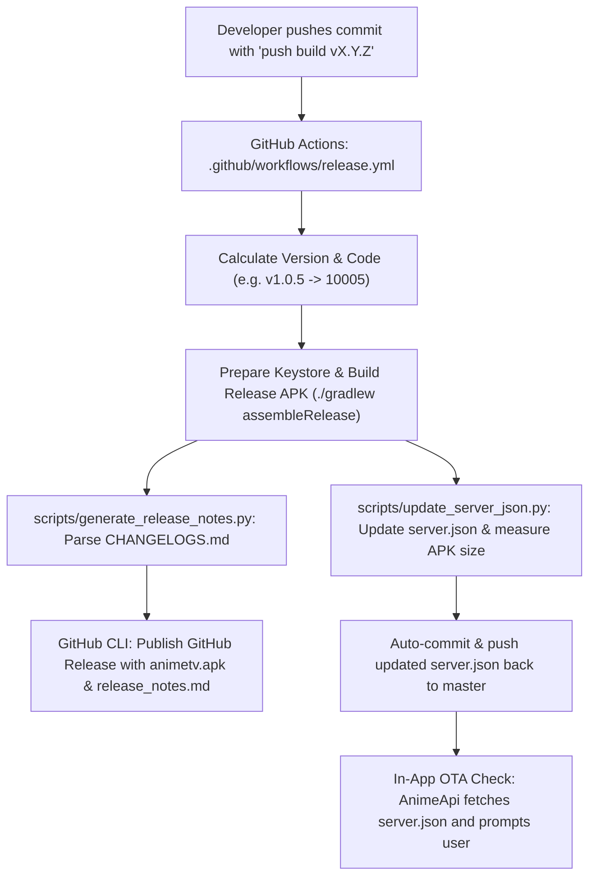

# AnimeTV Automatic APK Release & Changelog Workflow

This document explains how the automated CI/CD release pipeline, versioning, changelog extraction, and in-app over-the-air (OTA) updates work in AnimeTV.

---

## 1. Architecture Overview



---

## 2. Triggering a Release

The release workflow is defined in [`.github/workflows/release.yml`](../.github/workflows/release.yml).

### Method A: Commit Message (Recommended)

Include the trigger phrase `push build` (case-insensitive) in your commit message:

```bash
# Explicit version (Recommended)
git commit -m "Add new feature - push build v1.0.5"
# Or
git commit -m "push build 1.0.5"

# Auto-bump (bumps the patch version from previous git tag)
git commit -m "push build"
```

Supported trigger prefixes:
- `push build`
- `Push build`
- `Push Build`
- `PUSH BUILD`
- `push-build`
- `Push-Build`

### Method B: GitHub Actions Manual Dispatch

1. Go to **Actions** -> **Build & Publish Release APK**.
2. Click **Run workflow**.
3. (Optional) Provide a custom version tag like `v1.0.5`. If left empty, it will auto-bump the latest git tag.

---

## 3. Versioning & Version Code Logic

The workflow parses the version string into standard Semantic Versioning (`MAJOR.MINOR.PATCH`):

| Variable | Example Value | Description |
|---|---|---|
| `NEW_TAG` | `v1.0.5` | Git release tag |
| `CLEAN_VER` | `1.0.5` | Stripped version used in UI and configs |
| `APP_VERSION_NAME` | `1.0.5` | Android `versionName` |
| `APP_VERSION_CODE` | `10005` | Android integer `versionCode` |

### Version Code Formula
```text
APP_VERSION_CODE = (MAJOR * 10000) + (MINOR * 100) + PATCH
```
*Example: `1.0.5` -> `(1 * 10000) + (0 * 100) + 5 = 10005`*

If an explicit version is not in the commit message or manual inputs, the pipeline fetches the latest tag from git history and increments `PATCH`. If `PATCH >= 10`, it resets to `0` and increments `MINOR`, rolling over to `MAJOR` if `MINOR >= 10`.

---

## 4. Changelogs & Release Notes

### `CHANGELOGS.md` Format

The release notes generator specifically looks for version headers matching this exact format:

```markdown
# Changelogs
- **1.0.5**
  - Add feature X
  - Fix crash on TV navigation
  - Performance improvements
- **1.0.4**
  - Fix app startup crash and stabilize video buffer initialization
```

> [!IMPORTANT]
> The entry header must start with `- **<VERSION>**` (e.g. `- **1.0.5**`). Bullet points indented under the version header are automatically captured.

### How Changelog Extraction Works

Two Python scripts parse [`CHANGELOGS.md`](../CHANGELOGS.md) using regular expressions:

1. [`scripts/generate_release_notes.py`](../scripts/generate_release_notes.py):
   - Extracts the bullet points under `- **<CLEAN_VER>**`.
   - Generates `release-artifacts/release_notes.md` with the release title, bullet points, and Downloader code:
     ```markdown
     ### AnimeTV v1.0.5

     #### Changelog:
     - Add feature X
     - Fix crash on TV navigation
     - Performance improvements

     ---
     - **Downloader Code:** `1600676`
     ```
   - Passed directly to `gh release create` / `gh release edit --notes-file`.

2. [`scripts/update_server_json.py`](../scripts/update_server_json.py):
   - Extracts the same changelog snippet for the `appnote` field.
   - Measures actual output APK size using `du -h`.
   - Writes the updated JSON structure into [`server.json`](../server.json).

---

## 5. In-App Over-The-Air (OTA) Updates

AnimeTV checks for updates dynamically without requiring Google Play Store:

1. **GitHub Raw Fetch**:
   - `AnimeApi.java` queries:
     `https://raw.githubusercontent.com/paregi12/AnimeTV/master/server.json?<timestamp>`
2. **Version Check**:
   - The app compares the `update` field in `server.json` against `Conf.SERVER_VER`.
3. **User Prompt**:
   - If an update is detected, the frontend displays an update prompt showing `appnote` (the changelog).
4. **Direct Download**:
   - Clicking download pulls the latest APK directly from:
     `https://github.com/paregi12/AnimeTV/releases/latest/download/animetv.apk`

---

## 6. APK Signing & Keystores

The workflow supports both custom production keystores and automated fallback keystores:

```yaml
- Prepare Signing Keystore:
    If secrets.KEYSTORE_BASE64 exists:
      Decode base64 to keystore/release.keystore
      Use secrets.KEYSTORE_PASSWORD, secrets.KEY_ALIAS, secrets.KEY_PASSWORD
    Else:
      Automatically generate self-signed keystore with alias 'animetv'
```

To configure your own permanent keystore in GitHub:
- `KEYSTORE_BASE64`: Base64-encoded `.keystore` or `.jks` file (`base64 -w 0 release.keystore`).
- `KEYSTORE_PASSWORD`: Keystore password.
- `KEY_ALIAS`: Key alias.
- `KEY_PASSWORD`: Key password.

---

## 7. Step-by-Step Guide to Publish a Release

To publish a new release (e.g., `v1.0.5`):

1. **Update `CHANGELOGS.md`**:
   Add the new version at the top of the list:
   ```markdown
   - **1.0.5**
     - Description of your changes
   ```

2. **Commit Your Code and Changelog**:
   ```bash
   git add -A
   git commit -m "Prepare release v1.0.5"
   ```

3. **Push with Release Trigger**:
   ```bash
   git commit --amend -m "Add feature X - push build v1.0.5"
   # or simply
   git commit -m "push build v1.0.5"
   git push origin master
   ```

4. **Workflow Execution**:
   - GitHub Actions will build the release APK.
   - Publish GitHub Release `v1.0.5` with `animetv.apk` and formatted notes.
   - Update `server.json` and automatically commit `Update server.json to v1.0.5`.

5. **Pull the Automated Commit**:
   After the release completes, pull the updated `server.json` commit to keep your local branch in sync:
   ```bash
   git pull origin master
   ```

---

## 8. Debug APK Workflow

For intermediate testing without publishing a public release:
- **Trigger**: Include `push debug` in your commit message.
- **Workflow**: Defined in [`.github/workflows/build-debug.yml`](../.github/workflows/build-debug.yml).
- **Artifact**: Uploads `animetv-debug.apk` to GitHub Actions (retained for 14 days).
- **Direct Download**: Available via Nightly.link:
  `https://nightly.link/paregi12/AnimeTV/workflows/build-debug/master?preview`
