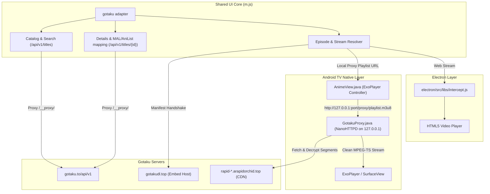

# Gotaku Source Integration Design

- **Date**: 2026-10-31
- **Target**: AnimeTV (Android TV / Mobile / Electron)
- **Status**: Approved Design

---

## 1. Objectives

1. Add **Gotaku** (`gotaku.to`) as Source #9 (`__SD9`) in AnimeTV.
2. Enable full **Catalog, Search, and Details** using Gotaku's open REST API (`/api/v1/titles`, `/api/v1/filters`).
3. Support **native ExoPlayer hardware playback** on Android TV via a lightweight local streaming proxy (`GotakuProxy.java` using NanoHTTPD), which decrypts AES-CTR obfuscated segments on the fly.
4. Support **HTML5 / Electron video playback** on Desktop via header interception.

---

## 2. Architecture Overview

---

## 3. Component Specifications

### 3.1 Frontend Adapter (`m.js`)

#### Source Registration
* `__SOURCE_NAME`: Append `'Gotaku'` (Index 8, SD = 9).
* `__SOURCE_DOMAINS`: Append `['gotaku.to']`.
* `const __SD9 = (__SD == 9);`

#### Adapter Contract (`gotaku` object)
* `animeId(url)`: Extracts title slug from `/title/{id}`.
* `getFilterOrigin()`: Headers for `/__proxy/` (`X-Org-Prox: https://gotaku.to`, `Referer: https://gotaku.to/`).
* `getFilterUrl(q, genres, sort, page, ses, year)`:
  * Generates `/api/v1/titles?query={q}&limit=28&page={page}&sort={sort}`.
  * Formats query params for genre, format (`TV`, `MOVIE`), and year.
* `recent_parse(data)`: Maps `/api/v1/titles` results to AnimeTV's home screen model:
  * `url`: `/title/{id}`
  * `title`: English / Romanized name
  * `poster`: Poster image CDN URL
  * `epavail`: Latest sub/dub episode count
* `getTooltip(id, cb, url, isview)`:
  * Queries `GET /api/v1/titles/{id}`.
  * Maps `links.mal` -> `malId` and `anilist_id` -> `anilistId` for AniSkip skipping.
  * Returns genres, synopsis, ratings, and backdrop/banner artwork.
* `getView(url, cb)`:
  1. Requests `/api/v1/titles/{id}/episodes?k=8` and decrypts binary body using AES-128-GCM + Zlib inflate.
  2. Resolves selected episode embed: `GET /api/v1/episodes/{epId}/embed?type={hard_sub|dub}&k=8`.
  3. Executes `ManifestHandshake` to retrieve `source` (CDN `.m3u8` playlist), `keySeed`, and `obf.segmentBytes`.
  4. On Android: Rewrites stream URL to `http://127.0.0.1:{proxy_port}/proxy/playlist.m3u8?url={m3u8}&key={keySeed}&sb={segmentBytes}&m3u8=1`.
  5. Passes skip intervals (`embed.skip.intro`, `embed.skip.outro`) to player.

---

### 3.2 Cryptographic Engine

Gotaku uses three cryptographic routines:

#### A. API Decryption (`?k=8`)
* **Key Derivation**: `Key = HKDF-SHA256(API_SEED, salt="", info="api-seal|v1", len=32)`.
* **Seed**:
  `[169, 97, 13, 229, 137, 106, 199, 91, 124, 53, 130, 103, 235, 216, 204, 41, 161, 207, 4, 157, 109, 106, 130, 5, 57, 176, 155, 55, 18, 148, 80, 128]`.
* **Wire Format**:
  `[version_byte (0x08)][12-byte IV][Ciphertext + 16-byte Tag]`.
* **Decryption**: AES-128-GCM -> Zlib Inflatation -> JSON string.

#### B. Manifest Handshake
* **Seed**: `458e5403c40a73332706df406193dd6b040a2ea97a6bb59b52b294a61006e6ef` (hex).
* **Payload**: `JSON { nonce: base64Url(random16Bytes), stamp: data_manifest_stamp }`.
* **Encryption**: AES-GCM under `MANIFEST_SEED` with 12-byte IV -> `base64url(IV + ct)`.
* **Response Decryption**: `Key = HKDF-SHA256(MANIFEST_SEED, salt=nonce, info="manifest-resp|v1", len=32)`.

#### C. Segment Unscrambling
* **Keystream**: AES-128-CTR initialized with `keySeed`.
* **Counter**: `SHA-256(segmentUrl)[0..7] + 8 zero bytes`.
* **Operation**: XOR first `segmentBytes` (e.g. 188 or 1024) with keystream; remainder of chunk is intact MPEG-TS.

---

### 3.3 Native Android Streaming Proxy (`GotakuProxy.java`)

* Embedded in Android package `com.amarullz.androidtv.animetvjmto`.
* Utilizes `org.nanohttpd:nanohttpd:2.3.1` bound to `127.0.0.1:0` (random ephemeral port).
* **Endpoints**:
  * `/proxy/playlist.m3u8`: Fetches CDN playlist, decrypts master playlist if encrypted (`HKDF(keySeed, token, "pl|v1")`), and rewrites all segment URIs to point to local `/proxy/segment.ts`.
  * `/proxy/segment.ts`: Fetches segment chunk from CDN, streams through AES-CTR keystream decrypter for first `sb` bytes, and outputs standard MPEG-TS with `Accept-Ranges: bytes` support.
  * `/proxy/subtitles.vtt`: Proxies subtitle tracks with proper CORS/MIME headers.

---

## 4. Error Handling & Resilience

* **Port Collision**: NanoHTTPD dynamically picks an available port (`new ServerSocket(0)`).
* **Key Rotation**: Built-in fallback to detect if `?k=` version changes.
* **Upstream Timeout / Network Drops**: Proxy returns `503 Service Unavailable` on segment timeout so ExoPlayer retries chunk without crashing playback.

---

## 5. Verification Plan

1. **Gradle Build Verification**: Ensure `app/build.gradle` builds cleanly with NanoHTTPD enabled.
2. **Frontend Search & Catalog Test**: Verify Gotaku loads on the home screen, browse rows, and returns search results.
3. **Episode Manifest Test**: Verify episode list unpacking from encrypted binary payload.
4. **Playback Test**: Verify playlist rewriting, segment decryption, and ExoPlayer playback on TV without dropped frames.
